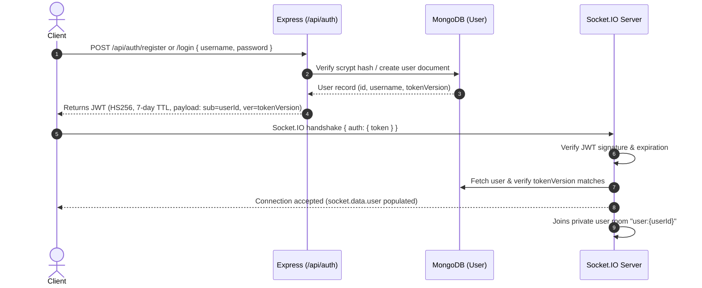
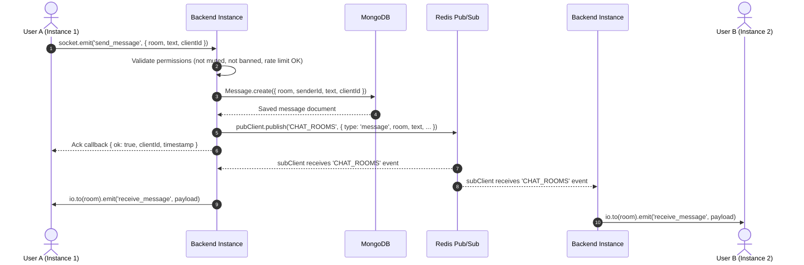

# Architecture

Gather Chat is a real-time collaborative chat application built for horizontal scalability, decoupled feature extensibility, and secure multi-tenant room management.

This document details the system design, communication flow, component responsibilities, data layer, and multi-instance scaling strategy.

---

## 1. System Overview

```
                      +-----------------------------+
                      |       Web / CLI Client      |
                      |  (Vite + React / Node CLI)  |
                      +--------------+--------------+
                                     |
                                     | HTTP REST & WebSocket (Socket.IO)
                                     v
                      +-----------------------------+
                      |   Reverse Proxy / Ingress   |
                      |    (Render / Vercel / Nginx)|
                      +--------------+--------------+
                                     |
               +---------------------+---------------------+
               |                                           |
               v                                           v
    +----------------------+                   +----------------------+
    | Backend Instance #1  |                   | Backend Instance #2  |
    | - Express REST API   |                   | - Express REST API   |
    | - Socket.IO Server   |                   | - Socket.IO Server   |
    | - Feature Plugins    |                   | - Feature Plugins    |
    +---+--------------+---+                   +---+--------------+---+
        |              |                           |              |
        | Mongoose     | Redis Pub/Sub             | Mongoose     | Redis Pub/Sub
        | Connection   | (`CHAT_ROOMS` channel)    | Connection   | (`CHAT_ROOMS` channel)
        v              v                           v              v
+---------------+  +-----------------------------------+  +---------------+
| MongoDB Base  |  |           Redis Broker            |  | MongoDB Base  |
| - Users       |  |  (Message & Event Distribution)   |  | (Shared Atlas |
| - Rooms       |  +-----------------------------------+  |  or Replica)  |
| - Messages    |                                         +---------------+
| - Reports     |
+---------------+
```

---

## 2. Core Components

### 2.1 Frontend Client Tier
- **Web App (`frontend/`)**: Vite + React single-page application communicating over Socket.IO client and Fetch REST API. Handles responsive chat layouts, markdown formatting, connection states, moderation panels, and direct messaging tabs.
- **Terminal Client (`cli-client.js`)**: Interactive Node.js command-line interface demonstrating headless Socket.IO authentication, room subscription, and terminal messaging.

### 2.2 Backend Application Tier (`backend/server.js`)
- **HTTP / REST Service**: Express 5 application serving authentication routes (`/api/auth`), full-text search (`/api/search`), and health readiness checks (`/health`).
- **Real-Time WebSocket Service**: Socket.IO 4 server managing stateful duplex connections, room joining, presence broadcasting, and packet-level rate limiting.
- **Dynamic Plugin Engine**: Self-discovering feature loader (`backend/features/*.js`) that decouples domain features from the core server loop without touching `server.js`.

### 2.3 Message Broker & Scalability Tier (`ioredis`)
- Multi-instance scaling relies on Redis Pub/Sub over the `CHAT_ROOMS` channel.
- Each backend instance maintains dedicated publisher (`pubClient`) and subscriber (`subClient`) connections.
- When an action occurs on any instance (new message, reaction, edit, deletion, moderation ban, or DM), it publishes an event envelope to Redis.
- All running backend nodes receive the envelope and relay the event to their locally connected sockets.

### 2.4 Persistence Tier (`mongoose`)
MongoDB persists historical records and state models:
- **`User`**: Account identity, unique usernames, salted scrypt password hashes, and `tokenVersion` for multi-device revocation.
- **`Room`**: Room metadata, `ownerId`, array of `moderators`, and lists of `mutedIds` and `bannedIds`.
- **`Message`**: Room messages, sender identity, client deduplication ID (`clientId`), deletion flags, reactions, and timestamps.
- **`Report`**: User-submitted moderation reports detailing offending messages and reasons.
- **`RoomAccess`**: Private room flags and authorized user invite lists.
- **`DirectThread` & `DirectMessage`**: 1-on-1 private messaging threads and isolated conversation history.
- **`MessageEdit`**: Audit timestamps for message revisions.

---

## 3. Data Flow & Communication Lifecycle

### 3.1 Authentication & Session Lifecycle


When a user logs out (`POST /api/auth/logout`):
1. `tokenVersion` is incremented in MongoDB.
2. All open sockets for `user:{userId}` across instances are immediately disconnected.
3. Any existing JWTs become invalid on their next verification.

---

### 3.2 Real-time Message Broadcast & Redis Fan-out


---

## 4. Feature Plugin System

To maintain high code quality and prevent monolithic growth, features are organized as modular plugins inside `backend/features/`:

```
backend/features/
├── directMessages.js    # 1-on-1 private threads and messaging
├── hardening.js         # Sliding-window rate limiters, payload caps, graceful shutdown
├── messageControls.js   # Message editing, user deletion, state syncing
├── privateRooms.js      # Room privacy flags and invitation controls
├── search.js            # Message search endpoint (/api/search) with cursor pagination
└── typing.js            # Ephemeral typing indicators relayed through Redis
```

### Plugin Contract
Each feature file can optionally export lifecycle hooks:
```javascript
// Invoked once at server startup after DB connection
export async function setup(context: { app, io, pubClient, subClient, allowedOrigins, publishEvent })

// Invoked whenever an authenticated client establishes a socket connection
export function onConnection(socket: Socket, context: FeatureContext)

// Invoked for every event arriving over the Redis CHAT_ROOMS channel
// Returns boolean: true if handled, false to continue down the chain
export function onRedisMessage(payload: RedisPayload): boolean
```

---

## 5. Moderation & Permission Hierarchy

Room roles follow a strict hierarchical permission model:

| Role | Assigned When | Capabilities | Restrictions |
| :--- | :--- | :--- | :--- |
| **Owner** | First user to create / join the room | Full control: promote/demote moderators, mute/unmute members, permanently ban users, delete any message, toggle room privacy, invite users | Cannot be moderated, muted, or removed by anyone |
| **Moderator** | Promoted by room owner (`set_moderator`) | Mute/unmute members, permanently remove members, delete member messages, inspect and dismiss reports | Cannot mute, ban, or delete messages of the Owner or fellow Moderators |
| **Member** | Regular user joining the room | Send messages, edit/delete own messages, react with emojis, report messages, view presence | Cannot mute, ban, or delete other users' messages |
| **Muted** | Added to `room.mutedIds` | Can read room messages and presence | Forbidden from emitting `send_message` |
| **Banned** | Added to `room.bannedIds` | None | Disconnected immediately via `removed_from_room` and barred from rejoining |

---

## 6. Security & Hardening Architecture

1. **Defense in Depth**:
   - HTTP request rate limiting: 120 requests/minute per client IP.
   - Socket connection limiting: 30 handshakes/minute per client IP.
   - Message sending rate limit: 10 messages per 10-second window per socket.
   - Room join rate limit: 20 joins per 10-second window per socket.
2. **Payload Protection**:
   - `maxHttpBufferSize` capped at 16 KB per socket frame.
   - Text messages truncated and validated to 1,000 characters.
   - Usernames and room names sanitized with length and character-set regex.
3. **Graceful Shutdown**:
   - Intercepts `SIGTERM` and `SIGINT`.
   - Rejects incoming connections and health checks (`503 Unavailable`).
   - Closes Socket.IO server, disconnects Redis pub/sub clients, and safely closes Mongoose database pools within a 10-second timeout window.
